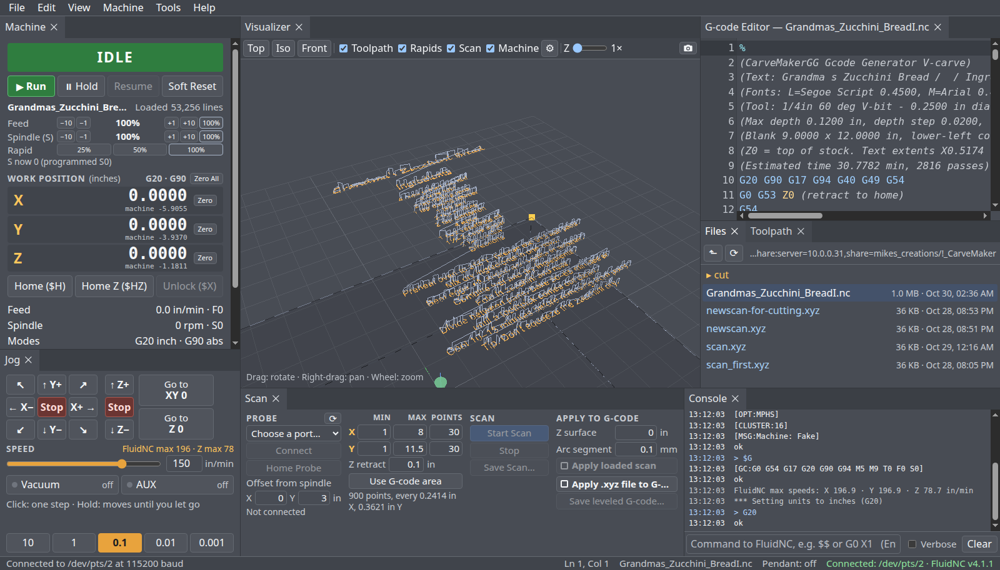

# FluidNCSender (FluidSender)

A lean, fast G-code sender made **only for FluidNC** CNC controllers. It was written to replace
Universal G-code Sender (UGS), which is slow to start and slow to draw on small PCs.

It runs as a small Python server (standard library only, no `pip install`) with a browser UI in its own
Chrome app window. It is **inch-first** everywhere.



## Features

- **Dockable multi-panel layout** (UGS-like): Files, G-code Editor, Visualizer/Toolpath, Machine,
  Motion control (Jog and Macros), Scan and Console. Drag panels around, float or maximize them (F11), and reset them from **View → Reset Layout**.
- **Dark, Medium and Light themes** (View → Theme).
- **G-code editor** synced with the 3D toolpath view. Save keeps the file's CRLF line endings.
- **Visualizer:** Top / Iso / Front views; **Toolpath**, **Rapids**, **Scan** and **Machine** checkboxes; a Z
  stretch; the **machine box** (the machine's travel, read from FluidNC, with its home corner); and a **camera
  button** that saves the view as a PNG.
- **Machine panel:** inch DRO, state badge, Hold / Resume / Soft Reset, Home ($H, $HX/$HY/$HZ), Unlock ($X),
  Zero per axis or all, **Undo Zero** (the last 5 zeros are kept), Go to XY 0 / Z 0, and feed / rapid / spindle overrides
  (amber when not 100 %).
- **"2nd chance" buttons:** Zero and Go-to buttons need a second click 0.5–3 s after the first.
  Double-clicks and keyboard presses never count, so a bumped button does nothing.
- **Motion control → Jog:** 3×3 XY pad with diagonals, Z+/Z−, Stop, and steps of 10 / 1 / 0.1 / 0.01 / 0.001 in.
  Click for one step, or hold to jog continuously. A speed slider is capped at FluidNC's own max rate.
- **Motion control → Macros:** your own G-code buttons (two clicks to run), kept in `settings.json`. Defaults:
  Park X / Y / Z axis (`G53 G0 X0`, `Y0`, `Z0`: rapids to machine zero, not homing).
- **Vacuum (M8) and AUX (M7) toggles** for solid-state relays. The program's own M7/M8/M9 set their state.
- **Job streaming** with character counting (128-byte buffer). Every job starts with `G20 G90`. It pauses on error,
  and **SAFE STOP** holds, waits for Hold:0, then resets.
- **Surface scan** with a Z probe ("the nano"), in UGS's zigzag order and `.xyz` format.
- **Auto-level** that matches UGS output byte for byte, with arcs split into short segments. One **Apply** box
  (blinks red while on). Saved leveled files are marked in their header and are **never leveled twice**.
- **Bluetooth jog pendant** support (NANO_jogbox, UGS plugin protocol).
- **Safe serial handling:** ports are opened exclusively and never opened by themselves. A port UGS holds is refused.
  The port is released 10 s after the last window closes, and only when the machine is at rest.

## Requirements

| What | Notes |
|---|---|
| Linux | Built and used on Ubuntu 24.04; **Linux Mint is the recommended platform** |
| or Windows 10 / 11 | Works too: see [Running on Windows](#running-on-windows) (less tested) |
| Python 3.8+ | Standard library only |
| Google Chrome | The UI runs in a `--app` window (set `FLUIDSENDER_BROWSER` to use Chromium) |
| `curl`, `ss` (iproute2) | Used by the launcher |
| FluidNC controller | Tested with FluidNC **4.1.1** (and 3.9.4) over USB at 115200 baud |
| Optional: probe | Arduino surface probe at 115200 (e.g. `/dev/ttyACM0`) |
| Optional: pendant | Bluetooth serial pendant on `/dev/rfcomm*` at 9600 |

## Quick start

```bash
git clone git@github.com:mikeoverbay/FluidNCSender.git ~/fluidsender
cd ~/fluidsender
./setup.sh            # checks requirements, serial access, and adds a desktop icon
./fluidsender.sh      # or double-click the "FluidSender" desktop icon
```

Then **Machine → Connect…**, pick your FluidNC port (usually `/dev/ttyUSB0`), and you're running.

## Running on Windows

Linux Mint is the recommended platform, but FluidSender runs on Windows 10 and 11 too:

1. Install **Python 3.12** (or newer) from [python.org](https://www.python.org/downloads/). In the installer, tick
   **Add python.exe to PATH**.
2. Get FluidSender: on GitHub press **Code → Download ZIP** and unzip it (or `git clone` it).
3. Double-click **`FluidSender.bat`** in the FluidSender folder.

It starts the server in a minimized window called *FluidSender server* (close that window to stop FluidSender) and
opens the page in a Chrome or Edge app window. In **Machine → Connect…** the FluidNC controller is a `COM` port
(`COM3`, …). The file list starts in your Documents folder. Windows can't tell which program has a port open, so a
port UGS holds is refused when FluidSender tries to open it (with that message), not marked in the list.

## Try it without a machine: Demo machine

**Machine → Connect…** lists a **Demo machine** last: a simulated FluidNC that runs inside FluidSender, on Linux and
Windows alike. Nothing real moves, but it answers like the real controller: it starts in ALARM (unhomed), **Home**
sends it home, jogs and Zero move the readout, the spindle speed shows a second after `M3 S…`, the vacuum / AUX
switches and overrides work, soft limits are on, and **Run** streams a G-code file. The status bar says
*Connected: Demo machine (simulated: nothing real moves)*. It is never chosen or connected by itself, and
**Disconnect** stops it.

## How-to guides

| Guide | |
|---|---|
| [Install and set up](docs/01-install.md) | setup.sh, serial permissions, desktop icon, options |
| [Connect to FluidNC](docs/02-connect.md) | ports, what is sent at connect, disconnecting |
| [Jog, home, zero and macros](docs/03-jog-and-zero.md) | Motion control (jog, macros), 2nd-chance zeroing, Undo Zero, Go to zero |
| [Run a job](docs/04-run-a-job.md) | open, check, run, hold, stop, overrides, Vac/AUX |
| [Surface scan and auto-level](docs/05-scan-and-level.md) | probe, scan settings, level, save leveled G-code |
| [Pendant](docs/06-pendant.md) | Bluetooth pairing, rfcomm, connecting |
| [Troubleshooting](docs/07-troubleshooting.md) | port busy, alarms, stuck states, logs |
| [Development and testing](docs/08-development.md) | layout of the code, simulators, test suite |

## Project layout

```
fluidsender.sh    launcher: starts the server if needed and opens the Chrome app window
FluidSender.bat   the same on Windows (Chrome or Edge)
setup.sh          one-time setup / requirements check
server.py         HTTP server + JSON API (port 8765)
machine.py        FluidNC link: streaming, status, safety rules
ports/           the serial ports: posix.py (Linux, termios), windows.py (COM ports, Win32), demo.py (the Demo machine)
hostos.py         the other Linux / Windows differences (the file list's start folder, the share)
job.py            job streaming
settings.py       settings.json (jog, scan, level, ports, zero history)
probe.py scan.py  surface probe and scan
leveling.py leveler.py   auto-level (UGS-compatible)
pendant.py        Bluetooth pendant
static/           the browser UI (vendored three.js, CodeMirror, dockview)
tools/            simulators: fake_fluidnc.py, fake_probe.py, fake_pendant.py
tests/            unit and end-to-end tests (run on the simulators)
docs/             how-to guides
```

## Safety

This software moves a real machine. Keep a hand near the **E-stop**. FluidSender's Stop, Hold and Soft Reset are
**not** a substitute for a hardware emergency stop.

## Credits

FluidSender builds on other people's work, and all credit for it goes to them:

- **[Universal G-code Sender (UGS)](https://github.com/winder/Universal-G-Code-Sender)** by **Will Winder and
  the UGS contributors** ([website and docs](https://winder.github.io/ugs_website/)), GPL-3.0. FluidSender's
  **auto-leveler** and **surface scan** are based on UGS's: re-implemented in Python from UGS's source, so a program
  is leveled exactly as UGS levels it, and scans are UGS `.xyz` files.
- **[FluidNC](https://github.com/bdring/FluidNC)** by **Bart Dring and the FluidNC contributors**
  ([documentation](http://wiki.fluidnc.com/)), GPL-3.0: the CNC controller FluidSender is made for.
- **[three.js](https://github.com/mrdoob/three.js)** by **the three.js authors** ([docs](https://threejs.org/docs/)),
  MIT: the 3D visualizer.
- **[CodeMirror 5](https://github.com/codemirror/codemirror5)** by **Marijn Haverbeke and others**
  ([manual](https://codemirror.net/5/doc/manual.html)), MIT: the G-code editor.
- **[dockview](https://github.com/dockview/dockview)** by **the dockview authors** ([docs](https://dockview.dev/)),
  MIT: the dockable panels.

Details and the license texts: **[THIRD-PARTY-NOTICES.md](THIRD-PARTY-NOTICES.md)**.

## License

FluidSender is free software: you can redistribute it and/or modify it under the terms of the
**[GNU General Public License](LICENSE)** as published by the Free Software Foundation, either version 3 of the
License, or (at your option) any later version, the same terms as Universal G-code Sender, from which its
auto-leveler and surface scan are derived. It comes with **no warranty**; see the license for details.

## Author

[@mikeoverbay](https://github.com/mikeoverbay)
